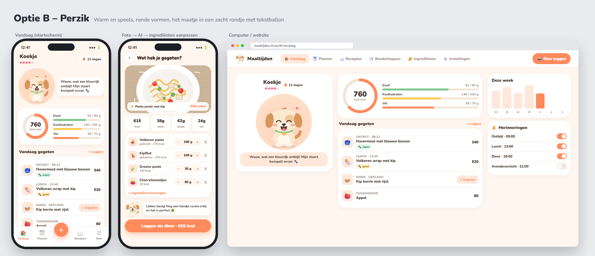
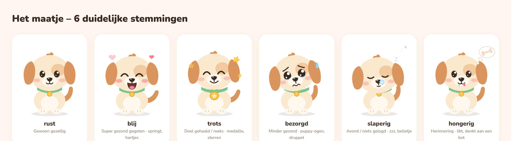
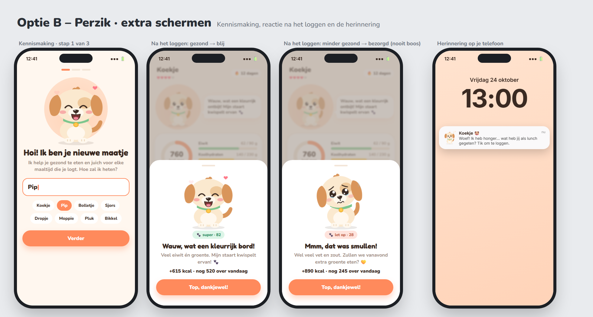

<p align="center">
  
</p>

<h1 align="center">Maaltijden</h1>

<p align="center">
  <b>Gezond eten wordt leuk, met een schattig hondje dat je aanmoedigt.</b><br>
  Maak een foto van je bord, en de AI rekent de calorieën uit. Plan je week, krijg vanzelf een boodschappenlijst,<br>
  en laat je maatje je herinneren om te loggen. Op je eigen server: geen abonnement, geen advertenties, jouw gegevens blijven thuis.
</p>

<p align="center">
  <a href="#installeren"><b>Installeren in 5 minuten</b></a> ·
  <a href="https://github.com/DGerding-2307/Maaltijden-app/releases/tag/android-latest">Android-app</a> ·
  <a href="docs/handleiding.md">Handleiding</a>
</p>



## 🐶 Maak kennis met Bolletje

Je nieuwe maatje is een getekend hondje dat met je meeleeft. Hij ademt, knippert en kwispelt. Na elke maaltijd die je logt, krijg je een
lief berichtje dat past bij hoe gezond je at. Super gezond? Dan springt hij van blijdschap. Een frietje? Dan kijkt hij een beetje bezorgd en
geeft hij een tip, maar boos wordt hij nooit. Geef hem zelf een naam: Bolletje, Koekje, Pip of iets heel anders.



- ❤️ **Hartjes** laten zien hoe gezond je vandaag eet, 🔥 je **reeks** hoeveel dagen je al op rij logt
- 🏅 Dagdoel gehaald of 7 dagen op rij? Dan krijgt hij een medaille
- ✨ Optioneel schrijft Claude (AI) elke keer een persoonlijk berichtje

## ✨ Wat kan het?

| | |
|---|---|
| 📷 **Foto → calorieën** | Geen idee wat er in je eten zit? Maak een foto. De AI herkent het gerecht, schat de ingrediënten en rekent kcal, eiwit, koolhydraten en vet uit. |
| 🥕 **Ingrediënten aanpassen** | Iets meer pasta, geen kaas? Pas per ingrediënt de hoeveelheid aan met – en +. De calorieën rekenen live mee, en je kunt het bewaren als je eigen recept. |
| 🔔 **Herinneringen** | Rond ontbijt, lunch en diner stuurt je maatje een seintje, maar alleen als je nog niets gelogd hebt. Via de Android-app, als pushmelding of via Home Assistant. |
| ➕ **Loggen in 3 tikken** | Eén grote knop: foto, zoeken, barcode scannen, of met één tik wat gepland stond of wat je vaak eet. |
| ▦ **Barcode scannen** | Producten uit Open Food Facts staan met één tik in je lijst. Onbekend product? Voeg het toe aan Open Food Facts, of laat de AI het etiket lezen. |
| 📅 **Weekplanner** | Plan je maaltijden en kies uit 50+ Nederlandse recepten, of laat Claude een weekmenu maken binnen je budget. |
| 🛒 **Boodschappenlijst** | Komt vanzelf uit je planning, per afdeling, met echte prijzen. Wat je al in huis hebt, vink je weg. |
| 📖 **Receptenboek** | Importeer recepten van elke website of van een foto, met voedingswaarden en prijs per portie. |
| ⚖️ **Dagboek & gewicht** | Je persoonlijke dagdoel, grafieken van je week en een gewichtstrend. |
| 👨‍👩‍👧 **Accounts** | Iedereen in huis een eigen account, dagboek en maatje. Recepten, planner en boodschappen deel je samen. |
| 🏡 **Home Assistant** | Het menu van vandaag, je boodschappen en je calorieën als sensoren op je dashboard. |
| 🌙 **Licht en donker** | Fris, rond en rustig, ook in donkere modus. Werkt op computer, telefoon, als app op je beginscherm en als Android-app. |



## 💛 Waarom Maaltijden?

- **Van jou.** Draait op je eigen server (bijvoorbeeld Unraid of een Raspberry Pi). Geen account bij een bedrijf, geen tracking.
- **Gratis.** Geen abonnement. Alleen voor de AI-functies gebruik je je eigen Claude-sleutel; een foto kost minder dan een cent.
- **Nederlands.** Nederlandse recepten, Nederlandse supermarktprijzen en voedingswaarden uit NEVO en Open Food Facts.
- **Voor het hele huishouden.** Samen plannen en boodschappen doen, en ieder een eigen dagboek en maatje.

## Nieuw in versie 4.0.2

- 🖼️ **Foto importeren bij recept toevoegen**: naast *📷 Foto maken* nu ook *🖼️ Kies foto of bestand*, voor een foto uit je galerij of een PDF
  (de app opende alleen de camera). Werkt meteen na de server-update, ook in de bestaande Android-app

## Nieuw in versie 4.0.1

- 🔔 **Meldingen in de Android-app werken**: ‘Aanzetten in de app’ plant de herinneringen nu echt in (installeer de nieuwe APK).
  Lukt het niet, dan zie je waarom, met ‘Opnieuw proberen’; met een oude app krijg je een link naar de nieuwe
- 🥕 **Ingrediënten aanpassen op de telefoon**: kaartjes in plaats van een brede tabel; tik op een ingrediënt om het te bewerken

## Nieuw in versie 4.0

- 🐶 Het maatje: een geanimeerd hondje met zes stemmingen, hartjes, een reeks en aanmoediging na elke maaltijd
- 🏠 Nieuw startscherm **Vandaag** en een grote ＋ om te loggen; op de telefoon een rustige onderbalk met 5 knoppen
- 📷 Foto van je eten → AI berekent de calorieën
- 🥕 Ingrediënten aanpassen bij het loggen en achteraf, en opslaan als eigen recept
- 🔔 Herinneringen op je telefoon (Android-app, pushmelding of Home Assistant), alleen als je nog niets gelogd hebt
- 👨‍👩‍👧 Accounts met een eigen dagboek per persoon; het eerste account wordt beheerder
- ▦ Scannen: onbekende producten toevoegen aan Open Food Facts, of het etiket laten lezen
- 🎨 Nieuwe huisstijl ‘Perzik’ met het hondje als app-icoon

## Installeren

### Unraid met Portainer

1. Open een terminal op Unraid en maak de map voor je gegevens:
   ```bash
   mkdir -p /mnt/user/appdata/maaltijden && chown 99:100 /mnt/user/appdata/maaltijden
   ```
2. Ga in Portainer naar **Stacks → Add stack**, noem hem `maaltijden` en plak dit:
   ```yaml
   services:
     maaltijden:
       image: ghcr.io/dgerding-2307/maaltijden-app:latest
       container_name: maaltijden
       restart: unless-stopped
       user: "99:100"
       ports:
         - "3000:3000"
       environment:
         UPDATER_URL: http://updater:8080
         UPDATER_TOKEN: ${UPDATE_TOKEN:-maaltijden-update}
       volumes:
         - /mnt/user/appdata/maaltijden:/app/data
       labels:
         - com.centurylinklabs.watchtower.enable=true

     updater:
       image: ghcr.io/nicholas-fedor/watchtower:1.22.3
       container_name: maaltijden-updater
       restart: unless-stopped
       volumes:
         - /var/run/docker.sock:/var/run/docker.sock
       environment:
         WATCHTOWER_LABEL_ENABLE: "true"
         WATCHTOWER_CLEANUP: "true"
         WATCHTOWER_SCHEDULE: "0 0 4 * * *"
         TZ: Europe/Amsterdam
         WATCHTOWER_HTTP_API_ENDPOINTS: update
         WATCHTOWER_HTTP_API_TOKEN: ${UPDATE_TOKEN:-maaltijden-update}
         WATCHTOWER_HTTP_API_PERIODIC_POLLS: "true"
   ```
3. Klik op **Deploy the stack** en open `http://<ip-van-je-server>:3000`.

### Andere server met Docker

```bash
mkdir maaltijden && cd maaltijden
curl -O https://raw.githubusercontent.com/DGerding-2307/Maaltijden-app/ccr-9030d78f-1ocilx/docker-compose.yml
curl -o .env https://raw.githubusercontent.com/DGerding-2307/Maaltijden-app/ccr-9030d78f-1ocilx/.env.example
docker compose up -d
```

Open daarna `http://<ip-van-je-server>:3000`. Je gegevens staan in `./data`.

### Updates

Gaan vanzelf: elke nacht om 04:00 wordt de nieuwste versie geïnstalleerd, met eerst een back-up van je gegevens.
Meteen bijwerken: in de app of op de website bij **Instellingen → Versie en updates → Nu updaten**. Staat er een nieuwe versie klaar,
dan zie je ook een melding met *Nu updaten*.

Al geïnstalleerd met een oudere stack? Neem de stack hierboven één keer over (Stacks → maaltijden → Editor → *Update the stack*).
Wil je een eigen geheime code voor de updater, zet dan bij *Environment variables* `UPDATE_TOKEN` op een zelfgekozen waarde.

### Android-app

Download `Maaltijden.apk` op je telefoon via [de nieuwste release](https://github.com/DGerding-2307/Maaltijden-app/releases/tag/android-latest),
open het bestand en vul het adres van je server in (bijv. `192.168.1.20:3000`).

### Optioneel

- **Claude (AI):** vul je API-sleutel in bij **Instellingen → Claude AI** in de app. Een sleutel maak je op [console.anthropic.com](https://console.anthropic.com).
- **Wachtwoord:** zet onder `maaltijden:` in de stack (of in `.env`) een wachtwoord. Doe dit zeker als de app vanaf internet bereikbaar is.
  ```yaml
       environment:
         APP_PASSWORD: kies-een-wachtwoord
  ```

Meer uitleg over alle functies staat in de [handleiding](docs/handleiding.md).

### Herinneringen instellen

Zet ze aan bij **Vandaag** (kaart *Herinneringen*) of bij **Account**, en kies hoe je ze wilt krijgen:

- **Android-app:** tik op *Aanzetten in de app*; de app plant de meldingen zelf in (ook als hij dicht is). Hiervoor heb je de Android-app van versie 4.0 nodig.
- **Pushmelding in de browser of webapp:** tik op *Aanzetten*. Dit werkt alleen als de app via **https** bereikbaar is (bijvoorbeeld via een reverse proxy of Nabu Casa); op een iPhone eerst *Zet op beginscherm*.
- **Home Assistant:** vul de naam van de meldingsdienst van je telefoon in (bijvoorbeeld `mobile_app_pixel_8`). Home Assistant moet gekoppeld zijn bij Instellingen.

### Accounts

Ga naar **Account** (rechtsboven of via *Meer*) en maak je account. Het eerste account wordt beheerder en kan huisgenoten toevoegen.
Daarna moet iedereen inloggen. Zonder accounts werkt de app zoals altijd, zonder inloggen.

---

<sub>Lettertypen: Nunito en Fredoka (SIL Open Font License). Voedingswaarden: NEVO (RIVM) en Open Food Facts (ODbL). Prijzen: Open Prices.</sub>
